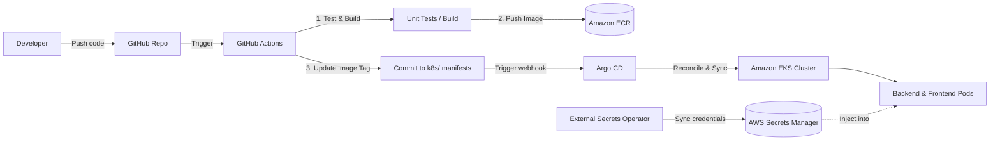

# The Matrix - Cloud-Native Exam Hall Allocation Portal

A modern, cloud-native Examination Hall Allocation and Seating Matrix Management Portal designed for universities and academic institutions, architected for AWS EKS, Amazon RDS, and GitOps via Argo CD.

---

## 🏛 Architecture Overview

```
The-Matrix/
│
├── frontend/                     # React Single-Page Application (TypeScript + Vite + Tailwind CSS)
│   ├── src/                      # Source code (Components, Pages, Contexts)
│   ├── public/                   # Static assets & report templates
│   ├── Dockerfile                # Nginx multi-stage build container
│   ├── nginx.conf                # SPA routing & /api reverse proxy
│   └── package.json              # UI dependencies
│
├── backend/                      # Python FastAPI REST API
│   ├── app/
│   │   ├── main.py               # API Gateway & lifespan setup
│   │   ├── database.py           # SQLAlchemy session engine
│   │   ├── config.py             # App environment settings
│   │   ├── models/               # SQLAlchemy models (User, Exam, Hall, etc.)
│   │   ├── schemas/              # Pydantic request/response schemas
│   │   ├── routes/               # Endpoints (/auth, /exams, /students, etc.)
│   │   ├── services/             # Seating matrix algorithm & allocation logic
│   │   └── auth/                 # JWT token generation & password security
│   ├── alembic/                  # Database migration versioning
│   ├── alembic.ini               # Alembic configuration
│   ├── requirements.txt          # Python dependencies
│   └── Dockerfile                # Python 3.11 container with health check
│
├── infrastructure/               # AWS Infrastructure as Code (Terraform)
│   └── terraform/
│       ├── main.tf               # Provider & tags setup
│       ├── vpc.tf                # Multi-AZ VPC, subnets, NAT Gateway
│       ├── rds.tf                # Amazon RDS PostgreSQL 16
│       ├── eks.tf                # AWS EKS cluster & managed node groups
│       ├── ecr.tf                # Amazon ECR registries (backend & frontend)
│       ├── iam.tf                # OIDC Provider, IRSA roles for ESO & ALB Controller
│       ├── secrets.tf            # AWS Secrets Manager credentials vault
│       ├── variables.tf          # Configurable environment inputs
│       └── outputs.tf            # ARNs, endpoints, and repository URLs
│
├── k8s/                          # Kubernetes Manifests
│   ├── namespace.yaml            # hall-allocation namespace
│   ├── ingress.yaml              # AWS ALB Ingress controller rules
│   ├── frontend/                 # Frontend Deployment & Service
│   │   ├── deployment.yaml
│   │   └── service.yaml
│   ├── backend/                  # Backend Deployment, Service, ConfigMap & ExternalSecret
│   │   ├── deployment.yaml
│   │   ├── service.yaml
│   │   ├── configmap.yaml
│   │   └── external-secret.yaml  # AWS Secrets Manager sync (Zero plaintext secrets in git)
│   └── monitoring/               # Helm Observability Stack Values
│       ├── namespace.yaml
│       ├── kube-prometheus-stack-values.yaml # Prometheus, Grafana & Alertmanager
│       ├── loki-values.yaml      # Grafana Loki (Log Aggregation)
│       ├── tempo-values.yaml     # Grafana Tempo (Distributed Tracing)
│       └── alloy-values.yaml     # Grafana Alloy (OpenTelemetry collector agent)
│
├── argocd/                       # GitOps CD Manifests (App-of-Apps)
│   ├── root-app.yaml             # Master Application
│   ├── application-backend.yaml  # Backend synchronization
│   ├── application-frontend.yaml # Frontend synchronization
│   ├── application-monitoring.yaml # Observability suite synchronization
│   └── application-external-secrets.yaml # External Secrets Operator synchronization
│
├── .github/workflows/            # Continuous Integration & Delivery
│   ├── backend-ci.yml            # Lint, test, build & push backend image to ECR
│   └── frontend-ci.yml           # Lint, build & push frontend image to ECR
│
├── docker-compose.yml            # Local development orchestration (with local Postgres)
└── README.md
```

---

## 🔒 Secret Management: AWS Secrets Manager + External Secrets Operator

To enforce enterprise security, **no database credentials or JWT keys are stored in Git or Kubernetes Secret manifests**.
- **Terraform (`secrets.tf`)** provisions an **AWS Secrets Manager** secret (`hall-allocation/backend-secrets`) containing the Amazon RDS connection string and generated JWT secret key.
- **Terraform (`iam.tf`)** creates an IAM Role for Service Accounts (**IRSA**) giving the External Secrets Operator permission to read the secret via AWS STS Web Identity.
- **`k8s/backend/external-secret.yaml`** configures an `ExternalSecret` resource that continuously synchronizes secrets from AWS Secrets Manager into an in-memory Kubernetes Secret (`app-secrets`).

---

## 📊 Full Observability Stack (Helm)

The monitoring architecture uses Helm charts managed declaratively via Argo CD:
1. **`kube-prometheus-stack`**: Automated Prometheus metrics scraping, Alertmanager rules, and Grafana dashboards.
2. **Grafana Loki**: Log aggregation and indexing.
3. **Grafana Tempo**: High-scale distributed tracing (OTLP gRPC/HTTP).
4. **Grafana Alloy**: Unified telemetry agent deployed as a DaemonSet for log collection, metrics forwarding, and trace pipelines.
5. **Pre-configured Grafana Data Sources**: Automatically links Prometheus, Loki, and Tempo in Grafana for unified trace-to-log drilldowns.

---

## 🔄 CI/CD & GitOps Pipeline



1. **Continuous Integration (GitHub Actions)**:
   - Runs linting and automated tests on PRs and commits to `main`.
   - Builds Docker images and pushes tagged versions (`${{ github.sha }}`) to **Amazon ECR**.
   - Updates the image tag in `k8s/backend/deployment.yaml` and `k8s/frontend/deployment.yaml`.
2. **Continuous Delivery (Argo CD)**:
   - Tracks the `main` branch.
   - Automatically synchronizes and reconciles desired state from Git to the **Amazon EKS** cluster.

---

## 🚀 Running Locally (Development)

Run the entire stack with a local PostgreSQL container:

```bash
docker compose up --build
```

- **Frontend**: [http://localhost:3000](http://localhost:3000)
- **FastAPI Swagger Docs**: [http://localhost:8000/docs](http://localhost:8000/docs)
- **Local PostgreSQL**: `localhost:5432`

---

## ☁️ Deploying on AWS

### 1. Provision Infrastructure with Terraform
```bash
cd infrastructure/terraform
terraform init
terraform plan
terraform apply
```

### 2. Connect to EKS Cluster
```bash
aws eks update-kubeconfig --region ap-south-1 --name hall-allocation-cluster
```

### 3. Bootstrap Argo CD
```bash
kubectl create namespace argocd
kubectl apply -n argocd -f https://raw.githubusercontent.com/argoproj/argo-cd/stable/manifests/install.yaml

# Apply the master App-of-Apps manifest
kubectl apply -f argocd/root-app.yaml
```
Argo CD will automatically provision:
- The `external-secrets` operator & AWS Secrets sync
- The `monitoring` namespace, `kube-prometheus-stack`, `loki`, `tempo`, and `alloy`
- The `hall-allocation` application (backend, frontend, ingress)
